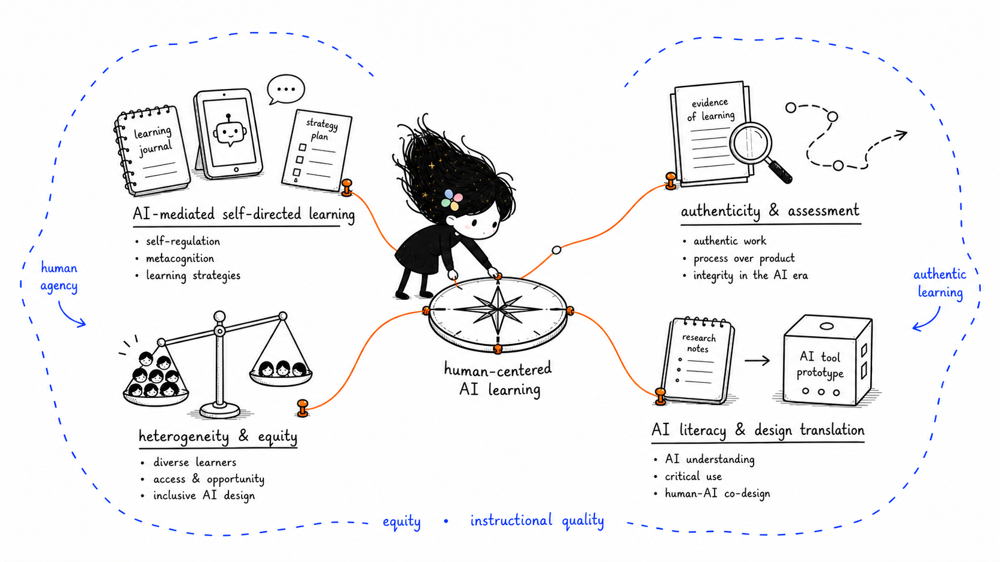

<nav class="page-section-nav" data-page-nav aria-label="Research page sections">
  

    <a class="page-section-nav__link" href="#strand-a">Agency &amp; SDL能动性与自主学习</a>
    <a class="page-section-nav__link" href="#strand-b">Authenticity &amp; Assessment真实性与评估</a>
    <a class="page-section-nav__link" href="#strand-c">Equity &amp; Heterogeneity公平性与学习者异质性</a>
    <a class="page-section-nav__link" href="#strand-d">Literacy &amp; DesignAI素养与学习设计</a>
    <a class="page-section-nav__link" href="#citation-reach">Citation Reach引用地图</a>
  

</nav>

My research examines how generative AI can support learning without displacing human agency. I study learner differences, authentic assessment, equity, and AI literacy, translating empirical evidence into learning designs that help people remain in charge of their learning.我的研究关注生成式人工智能如何支持学习，而不削弱人的主体能动性。我研究学习者差异、真实评价、教育公平与AI素养，并将实证发现转化为帮助学习者持续掌握主动权的学习设计。

<figure class="rp-overview-art" data-reveal>
  

    
    <button class="rp-map-hit rp-map-hit--a" type="button" data-zone="a" onclick="showPanel('a', true)">AI-mediated self-directed learning</button>
    <button class="rp-map-hit rp-map-hit--b" type="button" data-zone="b" onclick="showPanel('b', true)">Authenticity and assessment</button>
    <button class="rp-map-hit rp-map-hit--c" type="button" data-zone="c" onclick="showPanel('c', true)">Learner heterogeneity and equity</button>
    <button class="rp-map-hit rp-map-hit--d" type="button" data-zone="d" onclick="showPanel('d', true)">AI literacy and design translation</button>
  

</figure>

<b>Figure 1.</b> Four research strands in human-centered AI for learning. Click a region to open that strand.<b>图 1.</b> 以人为本的AI学习研究的四个方向。点击图中区域查看对应方向。

  <button id="strand-a" class="rp-tab" data-zone="a" onclick="showPanel('a')">Agency &amp; SDL能动性与自主学习</button>
  <button id="strand-b" class="rp-tab" data-zone="b" onclick="showPanel('b')">Authenticity &amp; Assessment真实性与评估</button>
  <button id="strand-c" class="rp-tab" data-zone="c" onclick="showPanel('c')">Equity &amp; Heterogeneity公平性与学习者异质性</button>
  <button id="strand-d" class="rp-tab" data-zone="d" onclick="showPanel('d')">Literacy &amp; DesignAI素养与学习设计</button>

  

    

    <h3 class="sp-head__title" id="sp-title"></h3>
    

  

  

<section class="citation-reach" id="citation-reach" data-citation-map data-reveal>
  

    
Research reach

    <h2 class="citation-reach__title">Where my work travels</h2>
    
Who builds on this research, located by the institutions of citing authors.

  

  

    

      ...
      citing works mapped in OpenAlex
    

    

      ...
      countries and regions
    

  

  

    

      
Citation geography data will appear here after the OpenAlex update script runs.

    

    
<b>Figure 2.</b> Citing works by the country of citing authors' institutions. Circle area is proportional to the number of citing works.

    

      

        <h3>Top citing regions</h3>
        <ol data-citation-countries>
          <li>Waiting for citation data.</li>
        </ol>
      

    

  

  
Source: OpenAlex. This map is based on DOI-linked records and does not represent total Google Scholar citations. Up to 200 citing works are sampled per source publication. Country counts use citing authors' institutional country metadata and exclude works without usable country information.

</section>

